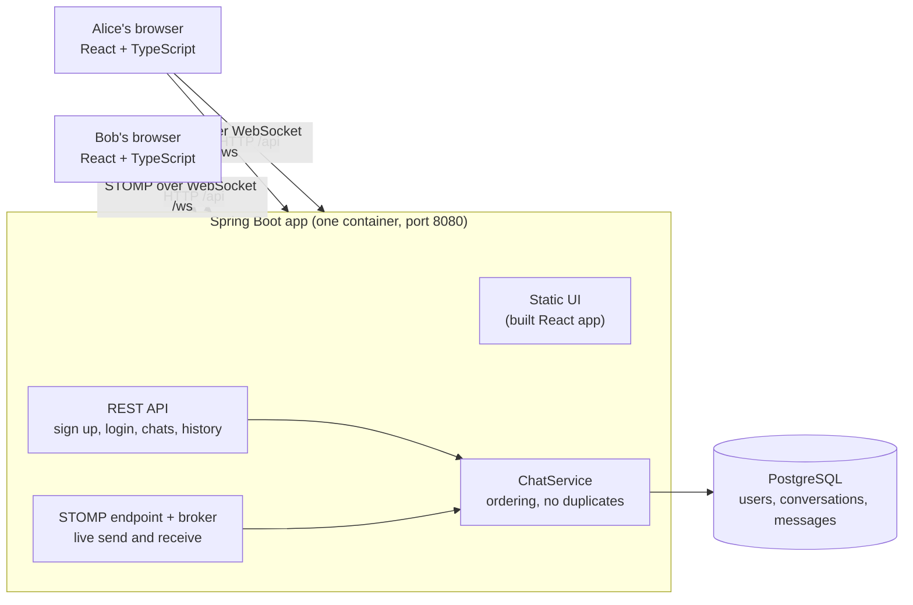
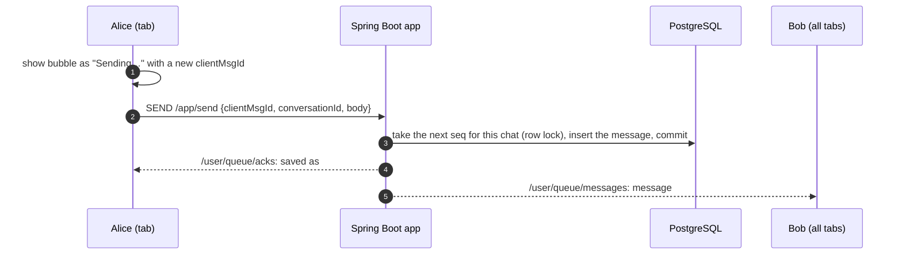

# Realtime Chat

A small real-time, one-to-one chat web app, like a minimal web WhatsApp. People sign up with their
email, start a chat by typing someone's email, and messages appear on the other person's screen
straight away. Once the server has a message, it arrives in the same order on every device,
survives refreshes and restarts, and is never lost or duplicated, even when the network drops.

**Contents:** [Tech stack](#tech-stack) · [Run it with Docker](#run-it-with-docker) ·
[System design](#system-design) · [What happens when Alice sends a message](#what-happens-when-alice-sends-a-message) ·
[Why it's built this way](#why-its-built-this-way) · [Known limitations and trade-offs](#known-limitations-and-trade-offs) ·
[Tests](#tests) · [Future use cases and improvements](#future-use-cases-and-improvements) ·
[API spec](#api-spec)

---

## Tech stack

- **Frontend:** React 19 + TypeScript, built with Vite; `@stomp/stompjs` for the WebSocket
- **Backend:** Java 25, Spring Boot 4.1
  - Spring Web MVC for the REST API
  - Spring WebSocket + STOMP with the in-memory broker for live messages
  - `JdbcTemplate` (plain SQL) and Flyway migrations
- **Database:** PostgreSQL 17
- **Packaging:** Docker Compose (app + database)
- **Tests:** JUnit (backend), Vitest (frontend)
- **Build tools:** Maven, npm

## Run it with Docker

You need [Git](https://git-scm.com/downloads) and [Docker Desktop](https://docs.docker.com/get-docker/).
Java, Maven, Node and Postgres all run inside containers.

```bash
git clone https://github.com/kalantrinikita/realtime-chat.git
cd realtime-chat
docker compose up --build
```

Open **http://localhost:8080** when the log shows `Started ChatApplication`. The first build takes a
few minutes; after that it starts in seconds.

To try it, create an account, then open the same address in a private window and create a second
account. From the second account, type the first account's email under *Start a chat* and send a message.

- Stop: `Ctrl+C` or `docker compose down` (data is kept).
- Delete all data: `docker compose down -v`.
- Postgres is on `localhost:5432` (database `chat`, user `chat`, password `chat-local-only`).
- Port already in use? Copy `.env.example` to `.env` and change `APP_PORT` or `DB_PORT`.

## System design



Each browser keeps one WebSocket connection to the Spring Boot app. When you send a message, the
server saves it with the next number (`seq`) in that chat, confirms it to you, and pushes it to
every open tab of both people.

- **REST API (`/api`):** sign up, log in, list chats, load older messages, catch up after a disconnect.
- **WebSocket (`/ws`, STOMP):** send messages and receive new ones live.
- **PostgreSQL:** stores users, sessions, conversations and messages. Nothing is shown to anyone
  until it's saved.

Messages are always ordered by `seq`, never by time.

## What happens when Alice sends a message



- **Bob is offline:** step 5 reaches nobody. When Bob opens the app, it loads every message after
  the last `seq` it has, so he gets them all, in order.
- **Alice's connection drops before step 4:** her app resends with the same `clientMsgId` when it
  reconnects, as long as the tab stays open. The server recognises it and returns the saved message
  instead of storing it twice.

## Why it's built this way

- **STOMP instead of raw WebSocket:** STOMP gives message routing, subscriptions, per-user queues and heartbeats out of the box, and `@stomp/stompjs` handles reconnecting, so the app's own code can focus on ordering, retries and access rules. The cost is a few STOMP pitfalls that had to be closed by hand: guessable user queues, no confirmation that a subscription is active, and frames processed in parallel.
- **Numbering by `seq` instead of timestamps:** clocks on different machines disagree and two messages can share a millisecond, while a per-chat counter taken under a row lock always matches the order messages were saved. Because the numbers have no gaps, "everything after 41" is a cursor that can't skip a message, and a jump from 41 to 43 tells the browser exactly what's missing.
- **Session cookie instead of JWT:** the browser's WebSocket API can't send an `Authorization` header but does send cookies, and an HttpOnly cookie can't be read by page scripts. Sessions live in the database, so logout takes effect immediately, even on open sockets, while a JWT stays valid until it expires.
- **Sending over the WebSocket instead of REST:** the socket is already open for receiving, so a send is one small frame instead of a full HTTP request, and the server handles each connection's frames in order, so two quick messages can't swap places. History and catch-up stay on REST, because they are simple request-and-response calls that are easy to page.

## Known limitations and trade-offs

- **Single server only:** the in-memory STOMP broker and `LiveSessionRegistry` both live inside one app instance, so with two instances, users on different servers wouldn't see each other's messages and a logout wouldn't close sockets on the other server.
- **Session expiry doesn't close open sockets:** the session is only checked when the WebSocket opens, so a socket opened before the 30-day expiry keeps working until it disconnects (logging out does close it straight away).
- **Account emails can be discovered:** login takes the same time whether or not an email exists, but sign-up answers "An account with this email already exists" and starting a chat answers "No user with that email", which both reveal it.
- **Unsent messages are kept only in memory:** a message typed while offline is resent when the connection comes back, but closing the tab before then loses it; once the server has acked a message, it's never lost.
- **Unread counts live in the browser:** they reset on refresh, because the server doesn't store how far each person has read.
- **New chats appear for the other person only with the first message:** starting a chat doesn't notify the other side, so an empty chat shows up for them once a message arrives.
- **Messages in one chat are saved one at a time:** the row lock that keeps `seq` in order makes two senders in the same chat wait for each other, which is unnoticeable with two people but would matter for a very busy group chat.
- **The message count assumes nothing is deleted:** the chat header shows `lastSeq` as the count, which would be wrong once messages can be deleted.

## Tests

| Suite | How to run | What it covers |
|---|---|---|
| Backend unit | `cd backend && mvn test`, or in IntelliJ right-click `src/test/java` → *Run All Tests* | Password hashing, message validation (emoji length, NUL character), the STOMP destination guard |
| Backend integration | Same, with `TEST_DATABASE_URL=jdbc:postgresql://localhost:5432/chat_test` set and the database running | 200 senders at once get gap-free numbers; retries never duplicate; two people starting the same chat get one conversation; outsiders can't read or write; paging and catch-up |
| Frontend | `cd frontend && npm test` | Chat state: duplicates, ordering, gap detection, messages arriving while history loads, lost acks, unread counts |

Integration tests are skipped when `TEST_DATABASE_URL` isn't set, and refuse to run against a
database whose name doesn't contain `test`, because they empty the tables. The `chat_test` database
is created the first time the Postgres volume is created. Unit tests also run during the Docker build.

## Future use cases and improvements

### New features

- **Delivered and read ticks (✓✓):** store one "delivered up to seq" and one "read up to seq" number per person per chat, and push it to the other person when it moves.
- **Typing indicator and online status:** send short-lived WebSocket events that are never stored, at most every few seconds, and hide them after a timeout.
- **Edit and delete messages:** keep the row and mark it edited or deleted so `seq` stays gap-free, then push the change to both people.
- **Search:** use Postgres full-text search (`tsvector` with a GIN index) over the messages in my own chats.
- **Group chats:** replace `user_low`/`user_high` with a `conversation_members` table, keep `seq` per conversation, and push each message to every member.
- **Images and files:** upload them to object storage (MinIO locally, S3 in the cloud) and store only a link in the message.
- **Notifications when offline:** send browser push notifications through a service worker.
- **Mobile app:** start with an installable web app (PWA), since a native app could reuse the same REST and WebSocket API.

### Technical improvements

- **Rate limiting:** limit login, sign-up and sending per IP and per user to stop password guessing and spam.
- **Account security:** add email verification, password reset and a lock after repeated failed logins.
- **More than one server:** replace the in-memory broker with RabbitMQ as an external STOMP broker, which is safe because clients catch up by `seq` when they switch servers.
- **Backups:** copy a nightly `pg_dump` off the server and regularly test restoring it.
- **Monitoring:** expose Spring Boot Actuator metrics for open sockets, send-to-ack time, slow-client disconnects and database pool waits.
- **End-to-end tests:** test two real users over the WebSocket with `WebSocketStompClient`, plus a browser test with Playwright.
- **Infrastructure as code:** create the server, firewall, disk and DNS record with Terraform instead of by hand.
- **Data growth:** partition the messages table by time and archive old chats.

## API spec

The REST API is under `/api`. Register and login set a session cookie, which the other endpoints
need. POST bodies must be JSON (`Content-Type: application/json`), and every error has the shape
`{"error": {"code": "...", "message": "..."}}`. Live messages go over the WebSocket at `/ws`; see
[WebSocket messages](#websocket-messages) below the spec.

To view it as interactive docs, paste the spec into [editor.swagger.io](https://editor.swagger.io).

```yaml
openapi: 3.0.3
info:
  title: Realtime Chat API
  version: 1.0.0
  description: REST API of the chat app. Live messages use the WebSocket at /ws, which is not part of this spec.
servers:
  - url: http://localhost:8080
security:
  - session: []

paths:
  /api/health:
    get:
      summary: Health check (also checks the database)
      security: []
      responses:
        '200':
          description: The app and the database are up
          content:
            application/json:
              schema:
                type: object
                properties:
                  status: { type: string, example: ok }
                  liveSockets: { type: integer, example: 2 }

  /api/config:
    get:
      summary: Settings the sign-up page needs
      security: []
      responses:
        '200':
          description: Whether sign-up needs an invite code
          content:
            application/json:
              schema:
                type: object
                properties:
                  inviteRequired: { type: boolean, example: false }

  /api/auth/register:
    post:
      summary: Create an account and sign in
      security: []
      requestBody:
        required: true
        content:
          application/json:
            schema: { $ref: '#/components/schemas/RegisterRequest' }
      responses:
        '201':
          description: Account created; the session cookie is set
          headers:
            Set-Cookie: { $ref: '#/components/headers/SessionCookie' }
          content:
            application/json:
              schema: { $ref: '#/components/schemas/UserResponse' }
        '400': { $ref: '#/components/responses/BadRequest' }
        '403':
          description: Wrong invite code
          content:
            application/json:
              schema: { $ref: '#/components/schemas/Error' }
        '409':
          description: An account with this email already exists
          content:
            application/json:
              schema: { $ref: '#/components/schemas/Error' }

  /api/auth/login:
    post:
      summary: Sign in
      security: []
      requestBody:
        required: true
        content:
          application/json:
            schema: { $ref: '#/components/schemas/LoginRequest' }
      responses:
        '200':
          description: Signed in; the session cookie is set
          headers:
            Set-Cookie: { $ref: '#/components/headers/SessionCookie' }
          content:
            application/json:
              schema: { $ref: '#/components/schemas/UserResponse' }
        '401':
          description: Incorrect email or password (same message for both)
          content:
            application/json:
              schema: { $ref: '#/components/schemas/Error' }

  /api/auth/logout:
    post:
      summary: Sign out, and close the WebSockets opened with this session
      security: []
      requestBody:
        content:
          application/json:
            schema: { type: object, example: {} }
      responses:
        '204':
          description: Signed out; the session cookie is cleared
          headers:
            Set-Cookie: { $ref: '#/components/headers/SessionCookie' }

  /api/me:
    get:
      summary: The signed-in user
      responses:
        '200':
          description: The current user
          content:
            application/json:
              schema: { $ref: '#/components/schemas/UserResponse' }
        '401': { $ref: '#/components/responses/Unauthorized' }

  /api/conversations:
    get:
      summary: My conversations, most recent first
      responses:
        '200':
          description: Each conversation with the other person and the last message
          content:
            application/json:
              schema:
                type: object
                properties:
                  conversations:
                    type: array
                    items: { $ref: '#/components/schemas/Conversation' }
        '401': { $ref: '#/components/responses/Unauthorized' }
    post:
      summary: Start (or reopen) a chat with the user who has this email
      requestBody:
        required: true
        content:
          application/json:
            schema:
              type: object
              required: [email]
              properties:
                email: { type: string, format: email, example: bob@example.com }
      responses:
        '200':
          description: The conversation (the same one if it already existed)
          content:
            application/json:
              schema:
                type: object
                properties:
                  conversation: { $ref: '#/components/schemas/Conversation' }
        '400': { $ref: '#/components/responses/BadRequest' }
        '401': { $ref: '#/components/responses/Unauthorized' }
        '404': { $ref: '#/components/responses/NotFound' }

  /api/conversations/{id}/messages:
    get:
      summary: Messages in a conversation, oldest first
      description: >
        With `after`, returns the messages after that seq (used to catch up).
        Otherwise returns the newest messages, or the newest before `before` (used for older pages).
      parameters:
        - { name: id, in: path, required: true, schema: { type: integer, format: int64 } }
        - { name: after, in: query, schema: { type: integer, format: int64 }, description: 'Return messages with seq greater than this' }
        - { name: before, in: query, schema: { type: integer, format: int64 }, description: 'Return messages with seq less than this' }
        - { name: limit, in: query, schema: { type: integer, default: 50, minimum: 1, maximum: 100 } }
      responses:
        '200':
          description: A page of messages
          content:
            application/json:
              schema:
                type: object
                properties:
                  messages:
                    type: array
                    items: { $ref: '#/components/schemas/Message' }
        '401': { $ref: '#/components/responses/Unauthorized' }
        '404': { $ref: '#/components/responses/NotFound' }

components:
  securitySchemes:
    session:
      type: apiKey
      in: cookie
      name: sid
      description: Set by register and login. Called __Host-sid when the app runs over HTTPS.

  headers:
    SessionCookie:
      description: The HttpOnly session cookie
      schema: { type: string }

  schemas:
    User:
      type: object
      properties:
        id: { type: integer, format: int64, example: 1 }
        email: { type: string, example: alice@example.com }
        displayName: { type: string, example: Alice Tan }

    UserResponse:
      type: object
      properties:
        user: { $ref: '#/components/schemas/User' }

    RegisterRequest:
      type: object
      required: [email, password]
      properties:
        email: { type: string, format: email, maxLength: 254, example: alice@example.com }
        password: { type: string, minLength: 8, maxLength: 128 }
        displayName: { type: string, maxLength: 50, description: 'Defaults to the part of the email before @' }
        inviteCode: { type: string, description: 'Only needed when /api/config says inviteRequired' }

    LoginRequest:
      type: object
      required: [email, password]
      properties:
        email: { type: string, example: alice@example.com }
        password: { type: string }

    Message:
      type: object
      properties:
        id: { type: integer, format: int64 }
        conversationId: { type: integer, format: int64 }
        seq: { type: integer, format: int64, description: 'Order of the message in its conversation (1, 2, 3, ...)' }
        senderId: { type: integer, format: int64 }
        clientMsgId: { type: string, format: uuid, description: 'Id chosen by the sender''s browser, reused on retries' }
        body: { type: string, minLength: 1, maxLength: 4000 }
        createdAt: { type: integer, format: int64, description: 'Epoch milliseconds, for display only' }

    Conversation:
      type: object
      properties:
        id: { type: integer, format: int64 }
        peer: { $ref: '#/components/schemas/User' }
        lastSeq: { type: integer, format: int64, description: 'seq of the newest message (0 if none)' }
        lastMessage:
          allOf: [{ $ref: '#/components/schemas/Message' }]
          nullable: true
        updatedAt: { type: integer, format: int64, description: 'Epoch milliseconds of the last activity' }

    Error:
      type: object
      properties:
        error:
          type: object
          properties:
            code: { type: string, example: validation_error }
            message: { type: string, example: Please enter a valid email address }

  responses:
    BadRequest:
      description: Invalid input (code validation_error)
      content:
        application/json:
          schema: { $ref: '#/components/schemas/Error' }
    Unauthorized:
      description: Not signed in (code unauthorized)
      content:
        application/json:
          schema: { $ref: '#/components/schemas/Error' }
    NotFound:
      description: No such conversation or user, or not yours (code not_found)
      content:
        application/json:
          schema: { $ref: '#/components/schemas/Error' }
```

### WebSocket messages

STOMP over WebSocket at `/ws`. The session cookie is checked when the connection opens. Every
message from the server has a `type` field.

| Direction | Destination | Payload |
|---|---|---|
| browser → server | `SEND /app/hello` | `{}`, sent right after subscribing |
| server → browser | `/user/queue/ready` | `{type: "ready", protocol: 1, user}`: subscriptions are active, catch up now |
| browser → server | `SEND /app/send` | `{clientMsgId, conversationId, body}` |
| server → browser | `/user/queue/acks` | `{type: "ack", clientMsgId, message}`: saved, `message.seq` assigned |
| server → browser | `/user/queue/messages` | `{type: "message", message}`: a new message in one of my chats (all my tabs) |
| server → browser | `/user/queue/errors` | `{type: "error", clientMsgId, code, message, retryable}` |

Only these destinations are allowed; anything else is dropped. Close code `4001` means "logged
out", and the browser stops reconnecting. If `protocol` in `ready` isn't the version the page's code
understands (a tab left open across a breaking deploy), the page reloads once to get the new code.
