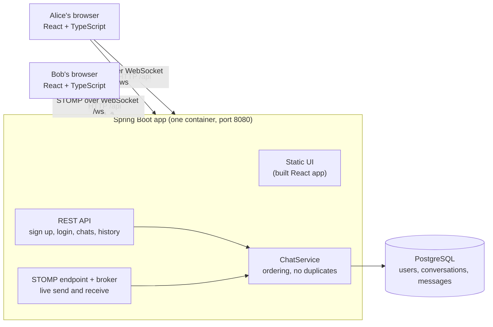
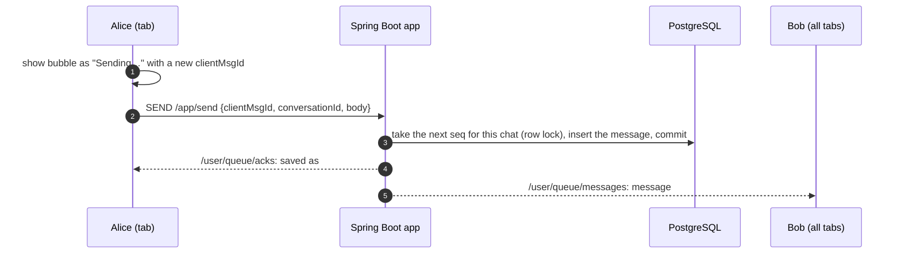

# Realtime Chat

A small real-time, one-to-one messaging web app, like a minimal web WhatsApp/Telegram. People sign
up with their email, find each other by email, and chat. Messages appear on the other person's
screen instantly, arrive in the same order on every device, survive refreshes and restarts, and are
never lost or duplicated when the network drops.

Contents: [Tech stack](#tech-stack) · [Use cases](#top-3-use-cases) · [System design](#system-design) ·
[Run it with Docker](#run-it-with-docker) · [What to expect](#what-to-expect) ·
[Run it from IntelliJ + VS Code](#run-it-from-intellij--vs-code) · [Tests](#tests) ·
[API and STOMP protocol](#api-and-stomp-protocol) · [Configuration](#configuration) ·
[Deploying to your own domain](#deploying-to-your-own-domain) · [Troubleshooting](#troubleshooting) ·
[Design notes: docs/DESIGN.md](docs/DESIGN.md)

---

## Tech stack

- **Frontend:** React 19 + TypeScript, built with Vite; `@stomp/stompjs` as the STOMP client
- **Backend:** Java 25 (builds on 21+), Spring Boot 4.1
  - Spring Web MVC for the REST API
  - Spring WebSocket + STOMP with the in-memory ("simple") broker for live messages
  - `JdbcTemplate` (plain SQL) + Flyway migrations
- **Database:** PostgreSQL 17
- **Packaging:** Docker + Docker Compose (two containers: app and database)
- **Testing:** JUnit (backend), Vitest (frontend)
- **Build tools:** Maven, npm
- **Production extra:** Caddy in front for automatic HTTPS on a real domain

## Top 3 use cases

1. **Sign up and find people:** create an account with your email; start a chat by typing someone's email.
2. **Real-time 1:1 chat:** messages show up instantly on the other person's screen, no refresh.
3. **Reliable across devices and bad networks:** same history in the same order on every tab and
   device; messages typed while offline are delivered when the connection returns; nothing is lost
   or duplicated.

**How a chat starts:** user A types user B's email under *Start a chat*. The server finds B's
account and creates (or reopens) the single conversation for that pair. A sends a message and it
appears on B's screen instantly with an unread badge. B must have signed up first.

**Where chats are stored:** in PostgreSQL. `users` holds accounts, `conversations` has one row per
pair of people, and `messages` holds every message with its order number. Under Docker the data
lives in a volume, so it survives restarts. The browser only keeps a temporary copy for display.

---

## System design



**In one sentence:** each browser keeps one live STOMP connection to the Spring Boot app. When you
send a message, the server saves it with the next number in that chat, confirms to you, and pushes
it to every screen the other person (and you) has open.

- **REST API** is for request/response work: sign up, log in, list my chats, load older messages,
  and catch up after a disconnect.
- **STOMP over WebSocket** is for live traffic: sending a message and receiving new ones without asking.
- **PostgreSQL** is the source of truth. Nothing is shown to anyone until it is saved.

### What happens when Alice sends a message



### Three promises and how they are kept

| Promise | How |
|---|---|
| **Same order everywhere** | Every message in a chat gets a number (seq) from the server, taken under a database row lock, so numbering follows commit order. Everyone sorts by that number, never by clock time. |
| **No duplicates** | The browser gives each message an id (clientMsgId) and reuses it on retry. A unique key in Postgres recognises the retry and returns the original instead of saving it twice. |
| **Nothing lost** | A message is saved before anyone is told. A device that was offline asks for "everything after #N" when it reconnects; a gap in the numbers triggers the same fetch. |

### When the connection drops

1. **Notice:** STOMP heartbeats every 10 s in both directions; no heartbeat means the connection is dead (a laptop waking from sleep, a phone switching networks).
2. **Reconnect:** each browser waits a random, growing delay before retrying, so a server restart isn't hit by every user at the same instant.
3. **Catch up:** after reconnecting, the browser subscribes, gets a "ready" signal, fetches everything after its last number, and resends anything still "Sending…" (safe thanks to clientMsgId).

### The 60-second version

> "Each browser keeps one STOMP-over-WebSocket connection to a Spring Boot app. Login and history go
> over a normal REST API. When you send a message, the server saves it in Postgres and gives it the
> next number in that chat under a row lock, then acks it to you and pushes it to the other person's
> open tabs through their personal STOMP queue. Everyone sorts by that number, so order is the same
> everywhere; each message carries a client id so retries never duplicate; and because everything is
> saved before anyone is told, an offline device just asks for 'everything after my last number' when
> it reconnects. Spring handles the WebSocket and STOMP plumbing; the ordering, de-duplication,
> catch-up and the security rules on which queues a client may use are written by hand."

More detail, trade-offs and edge cases: [docs/DESIGN.md](docs/DESIGN.md).

---

## Run it with Docker

**You need:** [Git](https://git-scm.com/downloads) and [Docker Desktop](https://docs.docker.com/get-docker/)
(or Docker Engine with Compose v2). Nothing else; Java, Maven, Node and Postgres run inside containers.
Give Docker at least 4 GB of RAM (Windows: enable the WSL 2 backend).

```bash
git clone https://github.com/<you>/realtime-chat.git
cd realtime-chat
docker compose up --build
```

Open **http://localhost:8080** once the log shows `Started ChatApplication`.

- First build: about 3–6 minutes (downloads images and dependencies, builds the UI, runs unit tests). Later starts take seconds.
- Stop: `Ctrl+C` or `docker compose down` (data is kept). Wipe all data: `docker compose down -v`.
- Port 8080 busy? Run `APP_PORT=8090 docker compose up --build`, or copy `.env.example` to `.env` and change it there.

## What to expect

1. A sign-in page. Click *Create an account*, use any email and a password of 8+ characters. No
   email is sent; the email is just your identity.
2. Open the same URL in a **private/incognito window** (or another browser) and create a second
   account. Two normal windows of one browser share cookies, so they'd be the same user.
3. As the second user, type the first user's email under *Start a chat* and send a message.
4. The first user sees the chat appear instantly with an unread badge. The pill at the top says
   **Live** while connected; your own messages show *Sending…* until the server confirms, then ✓.
5. Worth trying:
   - **Second tab** for the same user: both tabs receive everything, including what you send from the other.
   - **Restart the server:** `docker compose restart app`. The pill turns *Reconnecting…*; send a
     message meanwhile, and it is delivered automatically when the app is back (~10–20 s).
   - **Refresh** or restart everything: history comes back in the same order.
   - **Log out** in one tab: other tabs signed in with the same session are logged out too.
   - **Phone on the same Wi-Fi:** open `http://<your-computer's-IP>:8080`.

## Run it from IntelliJ + VS Code

Use this while changing code: the backend restarts in seconds and the UI hot-reloads.

**Install once:** Git, Docker Desktop, Node.js 22.12+ (or 24 LTS). IntelliJ has Maven built in, and
can download the JDK (*File → Project Structure → SDK → Download JDK → Eclipse Temurin 25*, or 21).

1. **Database:** in a terminal at the project root, run `docker compose up -d db`. `docker compose ps` should show it *healthy*.
2. **Backend (IntelliJ):**
   - *File → Open*, choose the `realtime-chat` folder. If it asks, click *Load* for the Maven project, or right-click `backend/pom.xml` and choose *Add as Maven Project*.
   - Open `backend/src/main/java/com/chatapp/ChatApplication.java` and click ▶ *Run*.
   - No settings are needed: the defaults in `application.yml` point at the Docker database on `localhost:5433`.
   - You should see `Started ChatApplication`.
3. **Frontend (VS Code):**
   - Open the `realtime-chat/frontend` folder.
   - In the terminal, run `npm ci` then `npm run dev`.
   - Open **http://localhost:5173**. Vite proxies `/api` and `/ws` to the backend on 8080.

Stop with Ctrl+C (VS Code), ■ (IntelliJ), and `docker compose stop db`.

## Tests

| Suite | How to run | What it covers |
|---|---|---|
| Backend unit | IntelliJ: right-click `backend/src/test/java` → *Run All Tests*, or `cd backend && mvn test` | Password hashing (incl. Unicode normalisation), message validation (emoji length, NUL), the STOMP destination guard (eavesdropping/spoofing blocked) |
| Backend integration | Same, with env var `TEST_DATABASE_URL=jdbc:postgresql://localhost:5433/chat_test` (database from `docker compose up -d db`) | 200 concurrent senders get a gap-free sequence; retries never duplicate or leave holes; simultaneous "start chat" creates one conversation; outsiders can't read/write; paging and catch-up |
| Frontend | `cd frontend && npm test` | Chat state: dedupe, ordering, gap detection, the "message arrives while history is loading" race, lost-ack reconciliation, unread counts |

Integration tests skip themselves without `TEST_DATABASE_URL`, and refuse any database whose name
doesn't contain `test` (they empty the tables). `chat_test` is created by `deploy/db-init/` the
first time the Postgres volume is created. Unit tests also run inside the Docker image build.

---

## API and STOMP protocol

### REST (`/api`, JSON)

| Method & path | Auth | Purpose |
|---|---|---|
| `GET /api/health` | – | Health + DB check (Docker healthcheck) |
| `GET /api/config` | – | `{inviteRequired}` for the sign-up form |
| `POST /api/auth/register` | – | `{email, password, displayName?, inviteCode?}` → sets the session cookie |
| `POST /api/auth/login` | – | `{email, password}` → sets the session cookie |
| `POST /api/auth/logout` | cookie | Ends the session and closes WebSockets opened with it |
| `GET /api/me` | cookie | Current user |
| `GET /api/conversations` | cookie | My chats, most recent first, with the other person and the last message |
| `POST /api/conversations` | cookie | `{email}` → get-or-create the chat with that user |
| `GET /api/conversations/{id}/messages` | cookie | `?after=seq` (catch-up, oldest first) or `?before=seq` (older page); `limit` ≤ 100 |

Errors look like `{"error": {"code": "...", "message": "..."}}`. POSTs must be `Content-Type: application/json` (part of the CSRF defence).

### STOMP over WebSocket (`/ws`)

| Direction | Destination | Payload |
|---|---|---|
| client → server | `SEND /app/hello` | `{}`, sent right after subscribing |
| server → client | `/user/queue/ready` | `{type:"ready", protocol:1, user}`: subscriptions are live, now catch up |
| client → server | `SEND /app/send` | `{clientMsgId, conversationId, body}` |
| server → client | `/user/queue/acks` | `{type:"ack", clientMsgId, message}`: stored, `message.seq` assigned |
| server → client | `/user/queue/messages` | `{type:"message", message}`: new message in one of my chats (all my tabs) |
| server → client | `/user/queue/errors` | `{type:"error", clientMsgId, code, message, retryable}` |

Only these destinations are allowed; anything else is dropped by `StompDestinationGuard`. WebSocket
close code `4001` means "logged out" (the client stops reconnecting).

## Project structure

```
realtime-chat/
├── docker-compose.yml           # db + app → http://localhost:8080
├── docker-compose.prod.yml      # adds Caddy (HTTPS), secure cookies, invite code
├── .env.example
├── deploy/
│   ├── Caddyfile                # production reverse proxy
│   └── db-init/                 # creates chat_test for integration tests
├── backend/                     # Spring Boot 4.1 (Maven)
│   ├── Dockerfile               # builds the UI + the jar into one image
│   └── src/main/java/com/chatapp/
│       ├── ChatApplication.java
│       ├── auth/                # accounts, sessions, cookie, interceptor, REST endpoints
│       ├── chat/                # ChatService (seq, idempotency, history) + REST endpoints
│       ├── realtime/            # STOMP config, handshake auth, destination guard, send/ack/push
│       ├── config/              # app properties, MVC config
│       └── common/              # errors, security headers
├── frontend/                    # React + TypeScript (Vite)
│   └── src/
│       ├── realtime.ts          # STOMP connection: heartbeats, jittered reconnect, ready handshake
│       ├── chatState.ts         # pure reducer: merge by seq, gap detection, pending/ack
│       ├── useChat.ts           # recovery: catch up on ready, resend pending, fill gaps
│       └── components/
└── docs/DESIGN.md               # decisions, trade-offs, edge cases, scaling path
```

## Configuration

Set in `.env` (see `.env.example`) or as environment variables.

| Variable | Default | Meaning |
|---|---|---|
| `APP_PORT` | `8080` | Port on your machine |
| `DB_PORT` | `5433` | Postgres on your machine (127.0.0.1 only) |
| `DB_PASSWORD` | `chat-local-only` | Postgres password (applied only when the volume is first created) |
| `INVITE_CODE` | *(empty)* | If set, sign-up requires this code |
| `COOKIE_SECURE` | `false` | `true` behind HTTPS (Secure cookie with `__Host-` prefix) |
| `ALLOWED_ORIGINS` | *(empty)* | Extra origins allowed to open the WebSocket (same-origin always works) |
| `SITE_ADDRESS` | – | Production only: your domain, for Caddy's automatic HTTPS |

App-level (outside Docker): `DATABASE_URL`, `DATABASE_USER`, `DATABASE_PASSWORD`, `DATABASE_POOL_SIZE`, `SESSION_TTL` (`30d`), `PORT` (`8080`).

## Deploying to your own domain

The same containers run on a server; only configuration changes. CI/CD and Terraform are the
planned next step (see [docs/DESIGN.md](docs/DESIGN.md#production-roadmap)).

1. A Linux server with Docker + Compose v2.24+, a public IP, ports **80** and **443** open.
2. At your DNS provider: an **A record** such as `chat.yourdomain.com → <server IP>`
   (if the domain has CAA records, they must allow `letsencrypt.org`).
3. On the server, clone the repo and create `.env`:
   ```bash
   SITE_ADDRESS=chat.yourdomain.com
   DB_PASSWORD=<long random string, e.g. openssl rand -base64 32>
   INVITE_CODE=<code you give your testers>
   ```
4. `docker compose -f docker-compose.yml -f docker-compose.prod.yml up -d --build`
5. Open `https://chat.yourdomain.com`. Caddy gets and renews the certificate automatically.

## Troubleshooting

| Symptom | Fix |
|---|---|
| Both windows show the same user | Use a private window or a second browser (same browser = same cookies). |
| `port is already allocated` | Change `APP_PORT` / `DB_PORT` in `.env`. |
| App log: `Found non-empty schema(s) ... without schema history table` | The database volume was created by an older version of this project. Run `docker compose down -v` once. |
| App log: `password authentication failed` after changing `DB_PASSWORD` | Postgres only applies the password when the volume is created: `docker compose down -v` (wipes data). |
| IntelliJ: app can't reach the database | Run `docker compose up -d db` first; the app expects Postgres on `localhost:5433`. |
| `bad interpreter: /usr/bin/env bash^M` (Windows) | Line endings: `.gitattributes` forces LF; re-clone, or `git config core.autocrlf input`. |
| Stuck on "Reconnecting…" | `docker compose ps` and `docker compose logs app`. The client retries with growing random delays (max 30 s) and immediately when the tab becomes visible or the network returns. |

## Known limitations (deliberate MVP scope)

One app instance (the in-memory STOMP broker lives in that process); no read receipts, typing
indicators, presence, group chats, attachments, push notifications or end-to-end encryption; no
login rate limiting or email verification yet. Each is discussed, with what it would take, in
[docs/DESIGN.md](docs/DESIGN.md).
