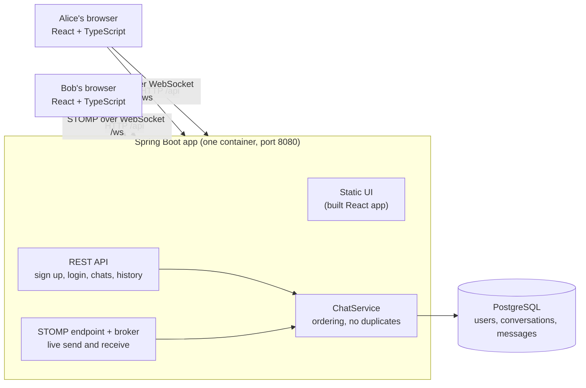
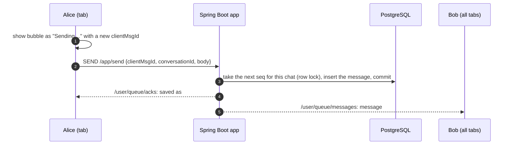

# Realtime Chat

A small real-time, one-to-one chat web app, like a minimal web WhatsApp. People sign up with their
email, start a chat by typing someone's email, and messages appear on the other person's screen
straight away. Messages arrive in the same order on every device, survive refreshes and restarts,
and are never lost or duplicated when the network drops.

**Contents:** [Tech stack](#tech-stack) · [Run it with Docker](#run-it-with-docker) ·
[System design](#system-design) · [What happens when Alice sends a message](#what-happens-when-alice-sends-a-message) ·
[Tests](#tests) · [API spec](#api-spec) · [Design notes](docs/DESIGN.md)

---

## Tech stack

- **Frontend:** React 19 + TypeScript, built with Vite; `@stomp/stompjs` for the WebSocket
- **Backend:** Java 25, Spring Boot 4.1
  - Spring Web MVC for the REST API
  - Spring WebSocket + STOMP with the in-memory broker for live messages
  - `JdbcTemplate` (plain SQL) and Flyway migrations
- **Database:** PostgreSQL 17
- **Packaging:** Docker Compose (app + database)
- **Tests:** JUnit (backend), Vitest (frontend)
- **Build tools:** Maven, npm

## Run it with Docker

You need [Git](https://git-scm.com/downloads) and [Docker Desktop](https://docs.docker.com/get-docker/).
Java, Maven, Node and Postgres all run inside containers.

```bash
git clone https://github.com/kalantrinikita/realtime-chat.git
cd realtime-chat
docker compose up --build
```

Open **http://localhost:8080** when the log shows `Started ChatApplication`. The first build takes a
few minutes; after that it starts in seconds.

To try it, create an account, then open the same address in a private window and create a second
account. From the second account, type the first account's email under *Start a chat* and send a message.

- Stop: `Ctrl+C` or `docker compose down` (data is kept).
- Delete all data: `docker compose down -v`.
- Postgres is on `localhost:5432` (database `chat`, user `chat`, password `chat-local-only`).
- Port already in use? Copy `.env.example` to `.env` and change `APP_PORT` or `DB_PORT`.

## System design



Each browser keeps one WebSocket connection to the Spring Boot app. When you send a message, the
server saves it with the next number (`seq`) in that chat, confirms it to you, and pushes it to
every open tab of both people.

- **REST API (`/api`):** sign up, log in, list chats, load older messages, catch up after a disconnect.
- **WebSocket (`/ws`, STOMP):** send messages and receive new ones live.
- **PostgreSQL:** stores users, sessions, conversations and messages. Nothing is shown to anyone
  until it's saved.

Messages are always ordered by `seq`, never by time. Why it's built this way, and the edge cases it
handles, are in [docs/DESIGN.md](docs/DESIGN.md).

## What happens when Alice sends a message



- **Bob is offline:** step 5 reaches nobody. When Bob opens the app, it loads every message after
  the last `seq` it has, so he gets them all, in order.
- **Alice's connection drops before step 4:** her app resends with the same `clientMsgId` when it
  reconnects. The server recognises it and returns the saved message instead of storing it twice.

## Tests

| Suite | How to run | What it covers |
|---|---|---|
| Backend unit | `cd backend && mvn test`, or in IntelliJ right-click `src/test/java` → *Run All Tests* | Password hashing, message validation (emoji length, NUL character), the STOMP destination guard |
| Backend integration | Same, with `TEST_DATABASE_URL=jdbc:postgresql://localhost:5432/chat_test` set and the database running | 200 senders at once get gap-free numbers; retries never duplicate; two people starting the same chat get one conversation; outsiders can't read or write; paging and catch-up |
| Frontend | `cd frontend && npm test` | Chat state: duplicates, ordering, gap detection, messages arriving while history loads, lost acks, unread counts |

Integration tests are skipped when `TEST_DATABASE_URL` isn't set, and refuse to run against a
database whose name doesn't contain `test`, because they empty the tables. The `chat_test` database
is created the first time the Postgres volume is created. Unit tests also run during the Docker build.

## API spec

The REST API is under `/api`. Register and login set a session cookie, which the other endpoints
need. POST bodies must be JSON (`Content-Type: application/json`), and every error has the shape
`{"error": {"code": "...", "message": "..."}}`. Live messages go over the WebSocket at `/ws`; those
are listed in [docs/DESIGN.md](docs/DESIGN.md#5-websocket-protocol).

To view it as interactive docs, paste the spec into [editor.swagger.io](https://editor.swagger.io).

```yaml
openapi: 3.0.3
info:
  title: Realtime Chat API
  version: 1.0.0
  description: REST API of the chat app. Live messages use the WebSocket at /ws (see docs/DESIGN.md).
servers:
  - url: http://localhost:8080
security:
  - session: []

paths:
  /api/health:
    get:
      summary: Health check (also checks the database)
      security: []
      responses:
        '200':
          description: The app and the database are up
          content:
            application/json:
              schema:
                type: object
                properties:
                  status: { type: string, example: ok }
                  liveSockets: { type: integer, example: 2 }

  /api/config:
    get:
      summary: Settings the sign-up page needs
      security: []
      responses:
        '200':
          description: Whether sign-up needs an invite code
          content:
            application/json:
              schema:
                type: object
                properties:
                  inviteRequired: { type: boolean, example: false }

  /api/auth/register:
    post:
      summary: Create an account and sign in
      security: []
      requestBody:
        required: true
        content:
          application/json:
            schema: { $ref: '#/components/schemas/RegisterRequest' }
      responses:
        '201':
          description: Account created; the session cookie is set
          headers:
            Set-Cookie: { $ref: '#/components/headers/SessionCookie' }
          content:
            application/json:
              schema: { $ref: '#/components/schemas/UserResponse' }
        '400': { $ref: '#/components/responses/BadRequest' }
        '403':
          description: Wrong invite code
          content:
            application/json:
              schema: { $ref: '#/components/schemas/Error' }
        '409':
          description: An account with this email already exists
          content:
            application/json:
              schema: { $ref: '#/components/schemas/Error' }

  /api/auth/login:
    post:
      summary: Sign in
      security: []
      requestBody:
        required: true
        content:
          application/json:
            schema: { $ref: '#/components/schemas/LoginRequest' }
      responses:
        '200':
          description: Signed in; the session cookie is set
          headers:
            Set-Cookie: { $ref: '#/components/headers/SessionCookie' }
          content:
            application/json:
              schema: { $ref: '#/components/schemas/UserResponse' }
        '401':
          description: Incorrect email or password (same message for both)
          content:
            application/json:
              schema: { $ref: '#/components/schemas/Error' }

  /api/auth/logout:
    post:
      summary: Sign out, and close the WebSockets opened with this session
      security: []
      requestBody:
        content:
          application/json:
            schema: { type: object, example: {} }
      responses:
        '204':
          description: Signed out; the session cookie is cleared
          headers:
            Set-Cookie: { $ref: '#/components/headers/SessionCookie' }

  /api/me:
    get:
      summary: The signed-in user
      responses:
        '200':
          description: The current user
          content:
            application/json:
              schema: { $ref: '#/components/schemas/UserResponse' }
        '401': { $ref: '#/components/responses/Unauthorized' }

  /api/conversations:
    get:
      summary: My conversations, most recent first
      responses:
        '200':
          description: Each conversation with the other person and the last message
          content:
            application/json:
              schema:
                type: object
                properties:
                  conversations:
                    type: array
                    items: { $ref: '#/components/schemas/Conversation' }
        '401': { $ref: '#/components/responses/Unauthorized' }
    post:
      summary: Start (or reopen) a chat with the user who has this email
      requestBody:
        required: true
        content:
          application/json:
            schema:
              type: object
              required: [email]
              properties:
                email: { type: string, format: email, example: bob@example.com }
      responses:
        '200':
          description: The conversation (the same one if it already existed)
          content:
            application/json:
              schema:
                type: object
                properties:
                  conversation: { $ref: '#/components/schemas/Conversation' }
        '400': { $ref: '#/components/responses/BadRequest' }
        '401': { $ref: '#/components/responses/Unauthorized' }
        '404': { $ref: '#/components/responses/NotFound' }

  /api/conversations/{id}/messages:
    get:
      summary: Messages in a conversation, oldest first
      description: >
        With `after`, returns the messages after that seq (used to catch up).
        Otherwise returns the newest messages, or the newest before `before` (used for older pages).
      parameters:
        - { name: id, in: path, required: true, schema: { type: integer, format: int64 } }
        - { name: after, in: query, schema: { type: integer, format: int64 }, description: Return messages with seq greater than this }
        - { name: before, in: query, schema: { type: integer, format: int64 }, description: Return messages with seq less than this }
        - { name: limit, in: query, schema: { type: integer, default: 50, minimum: 1, maximum: 100 } }
      responses:
        '200':
          description: A page of messages
          content:
            application/json:
              schema:
                type: object
                properties:
                  messages:
                    type: array
                    items: { $ref: '#/components/schemas/Message' }
        '401': { $ref: '#/components/responses/Unauthorized' }
        '404': { $ref: '#/components/responses/NotFound' }

components:
  securitySchemes:
    session:
      type: apiKey
      in: cookie
      name: sid
      description: Set by register and login. Called __Host-sid when the app runs over HTTPS.

  headers:
    SessionCookie:
      description: The HttpOnly session cookie
      schema: { type: string }

  schemas:
    User:
      type: object
      properties:
        id: { type: integer, format: int64, example: 1 }
        email: { type: string, example: alice@example.com }
        displayName: { type: string, example: Alice Tan }

    UserResponse:
      type: object
      properties:
        user: { $ref: '#/components/schemas/User' }

    RegisterRequest:
      type: object
      required: [email, password]
      properties:
        email: { type: string, format: email, maxLength: 254, example: alice@example.com }
        password: { type: string, minLength: 8, maxLength: 128 }
        displayName: { type: string, maxLength: 50, description: Defaults to the part of the email before @ }
        inviteCode: { type: string, description: Only needed when /api/config says inviteRequired }

    LoginRequest:
      type: object
      required: [email, password]
      properties:
        email: { type: string, example: alice@example.com }
        password: { type: string }

    Message:
      type: object
      properties:
        id: { type: integer, format: int64 }
        conversationId: { type: integer, format: int64 }
        seq: { type: integer, format: int64, description: Order of the message in its conversation (1, 2, 3, ...) }
        senderId: { type: integer, format: int64 }
        clientMsgId: { type: string, format: uuid, description: Id chosen by the sender's browser, reused on retries }
        body: { type: string, minLength: 1, maxLength: 4000 }
        createdAt: { type: integer, format: int64, description: Epoch milliseconds, for display only }

    Conversation:
      type: object
      properties:
        id: { type: integer, format: int64 }
        peer: { $ref: '#/components/schemas/User' }
        lastSeq: { type: integer, format: int64, description: seq of the newest message (0 if none) }
        lastMessage:
          allOf: [{ $ref: '#/components/schemas/Message' }]
          nullable: true
        updatedAt: { type: integer, format: int64, description: Epoch milliseconds of the last activity }

    Error:
      type: object
      properties:
        error:
          type: object
          properties:
            code: { type: string, example: validation_error }
            message: { type: string, example: Please enter a valid email address }

  responses:
    BadRequest:
      description: Invalid input (code validation_error)
      content:
        application/json:
          schema: { $ref: '#/components/schemas/Error' }
    Unauthorized:
      description: Not signed in (code unauthorized)
      content:
        application/json:
          schema: { $ref: '#/components/schemas/Error' }
    NotFound:
      description: No such conversation or user, or not yours (code not_found)
      content:
        application/json:
          schema: { $ref: '#/components/schemas/Error' }
```
